# Property Management and Rental Management Relationship in web 

## Purpose

This document explains how the Property Management workspace and the separate Rental Management screen relate in the current application. They share property and unit context, but they serve different workflows and use different save APIs.

## Relationship at a glance

```mermaid
erDiagram
    COMPANY ||--o{ PROPERTY : scopes
    PROPERTY ||--o{ PROPERTY_MASTER : contains
    PROPERTY ||--o{ PROPERTY_RENTAL : identifies
    PROPERTY_MASTER ||--o{ PROPERTY_RENTAL : unit_for
    USER_RECORD o|--o{ PROPERTY_RENTAL : optional_tenant

    COMPANY {
        int CompanyID
    }
    PROPERTY {
        int PropertyID
        int CompanyID
    }
    PROPERTY_MASTER {
        int RecordID
        int PropertyID
        string FlatNo
    }
    PROPERTY_RENTAL {
        int RentalID
        int CompanyID
        int PropertyID
        int RecordID
        int TenantUserID
        string RentalStatus
        date LeaseStartDate
        date LeaseEndDate
    }
    USER_RECORD {
        int UserID
        int PropertyID
        int RecordID
    }
```

The diagram describes the logical relationships used by the application, not verified database foreign keys. Property APIs call SQL Server stored procedures, and their definitions/schema are not present in this repository.

| Identifier | Meaning |
|---|---|
| `CompanyID` | Company scope for property and rental operations. |
| `PropertyID` | Top-level property, such as a building or site. |
| `RecordID` | Property Master unit/flat within a property. |
| `RentalID` | Rental-contract record managed by the Property Management Rental tab. |
| `TenantUserID` | Optional tenant/user reference accepted by the rental-contract API. |

Use the combination of `PropertyID` and `RecordID` to identify a unit in the property. `RentalID` identifies the contract for that unit; it is not the property or unit identifier.

## Two screens, two responsibilities

### Property Management — Rental tab

Open `/PropertyManagement` and select **Rental**. This tab manages the contract attached to a selected property and Property Master unit, including tenant name, rent, deposit, status, lease dates, payment frequency, and renewal terms.

It uses the dedicated property-rental endpoints:

- `GET /api/getPropertyRental`
- `GET /api/getPropertyRentalByID`
- `POST /api/insertUpdatePropertyRental`
- `DELETE /api/deletePropertyRental`

The create/update request requires `CompanyID`, `PropertyID`, `RecordID`, and `UserID`; it also includes `RentalID` (zero for a new record) and contract fields. `TenantUserID` can optionally link the contract to a tenant user.

### Rental Management — tenant and payment screen

Open **Rental Management** from the sidebar (`/Userinfo`). This screen combines tenant/user maintenance with property/unit selection, availability checks, rental-context display, and payment transactions.

It loads company properties and their units and rental rows, and uses:

- `POST /api/InsertUpdateUser` and `POST /api/Deleteusers` for tenant/user records.
- `GET /api/checkFlatAvailability` to check a selected property/unit.
- `GET /api/getRentalTransactions`, `POST /api/saveRentalTransactions`, and `POST /api/deleteRentalTransaction` for payment transactions and supporting files.

This screen does **not** call `POST /api/insertUpdatePropertyRental` when saving the tenant/user record. Therefore, use the Property Management **Rental** tab to create or update the dedicated rental-contract record and persist its contract fields. A tenant record and a rental contract are related, but they are not interchangeable records.

## Suggested operating sequence

1. Create a property under the appropriate `CompanyID`.
2. Add its flats/units in **Property Master** and retain each unit's `RecordID`.
3. Create or update the unit's rental contract in Property Management **Rental** using `PropertyID` and `RecordID`.
4. Create or update the tenant in **Rental Management**, selecting the same property and unit.
5. Add and maintain payment transactions in Rental Management.
6. Keep the company, property, unit, tenant, and contract identifiers consistent when moving between the screens.

## Integration note: transaction `RentID`

The transaction API requires `CompanyID`, `PropertyID`, and `RentID`. In the current Rental Management frontend, transaction requests set `RentID` to the selected tenant record's `UserId`. The stored-procedure definition is not in this repository, so whether `RentID` is intended to identify a user or a rental contract cannot be confirmed here. Verify this mapping against the database procedure before relying on transaction-to-contract reporting.

## Source locations

- Property Management workspace: `Frontend/pages/Operations/PropertyManagement/PropertyManagement.jsx`
- Property Management Rental tab: `Frontend/pages/Operations/PropertyManagement/RentalInformation.jsx`
- Rental Management screen: `Frontend/pages/Operations/MasterControl/RentalInfo.jsx`
- Property rental API routes: `Backend/routes/Operations/PropertyManagement/propertyInformation.js`
- Property rental controller: `Backend/controllers/property/propertyRentalController.js`
- Rental transaction controller: `Backend/controllers/property/propertyTransactionController.js`
