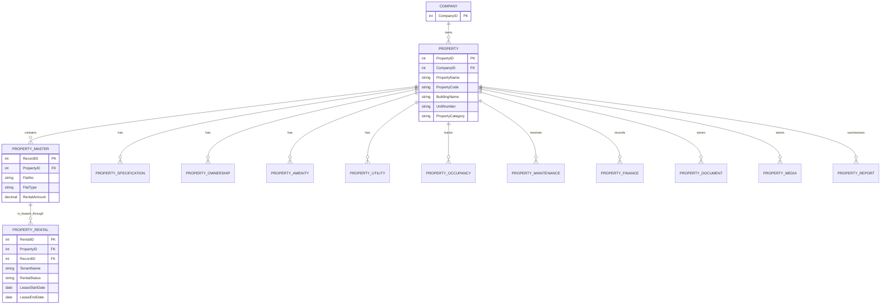

# Property Module Workflow

## 1. Purpose

The Property Management module is a property workspace for creating and maintaining property records, units, rental contracts, ownership, operations, finance, files, and reports.

The frontend entry point is the Property Management page. The backend exposes the property APIs under the `/api` prefix.

## 2. Navigation Structure

The Property Management screen currently contains these submodules:

1. Dashboard
2. Property
3. Property Master
4. Specification
5. Amenities
6. Ownership
7. Rental
8. Documents
9. Media
10. Utilities
11. Occupancy
12. Maintenance
13. Financial
14. Report

The submodules are displayed as tabs in the Property Management workspace.

## 3. Entity Relationship



### Key relationship rules

- `CompanyID` scopes the data to the logged-in company.
- `PropertyID` identifies the top-level property and is required by every property submodule.
- `Property Master.RecordID` identifies a unit, flat, or space within a property.
- Rental data must contain both `PropertyID` and `RecordID`.
- `RentalID` identifies the rental contract linked to a specific property unit.
- A property can have many units and many records in property-level submodules.
- A unit can have rental history; the active rental is identified by its status and lease dates.

## 4. Recommended Business Workflow

### Step 1: Create the property

Use the **Property** tab to create the parent property record.

Required context:

- `CompanyID`
- `UserID`
- `PropertyName`
- Property location and classification fields as required by the business

The system returns or stores the new `PropertyID`.

### Step 2: Configure units

Open **Property Master** for the selected property and create one record for each flat, office, shop, or other unit.

Each unit receives a `RecordID`. Typical unit fields include:

- Flat or unit number
- Flat type
- Rental amount
- Tenant name, where applicable
- Cheque and payment information, where configured

### Step 3: Add property details

Complete the property-level tabs using the same `PropertyID`:

- **Specification:** physical and technical specifications
- **Amenities:** facilities and services available at the property
- **Ownership:** owner or stakeholder information
- **Utilities:** utility accounts, providers, meters, and charges
- **Documents:** property-related documents
- **Media:** property images and media
- **Financial:** acquisition, valuation, expenses, tax, and return information

### Step 4: Create a rental record in Property Management

Open the **Rental** tab in Property Management and select a unit from Property Master. This screen uses the dedicated property-rental API to save contract fields.

The rental save request must include:

```json
{
  "RentalID": 0,
  "CompanyID": 1,
  "PropertyID": 100,
  "RecordID": 1001,
  "UserID": 25,
  "TenantName": "Tenant name",
  "RentalStatus": "Occupied",
  "MonthlyRent": 5000,
  "AnnualRent": 60000,
  "LeaseStartDate": "2026-01-01",
  "LeaseEndDate": "2026-12-31"
}
```

For an existing rental, send its `RentalID` and retain the same `PropertyID` and `RecordID` relationship.

### Combined Rental Management screen (`/Userinfo`)

The sidebar's **Rental Management** entry opens a combined tenant, property/unit, availability, and transaction screen. It is separate from the Property Management **Rental** tab:

1. The screen loads tenant/user records and properties, then loads each property's units and rental rows to display the related data together.
2. Select a property and unit. The screen checks availability with `GET /api/checkFlatAvailability`.
3. Create or edit the tenant/renter record through `POST /api/InsertUpdateUser`, including `PropertyID` and `RecordID`. This endpoint saves the user/tenant record; it does not call `POST /api/insertUpdatePropertyRental`.
4. Manage payment transactions through `GET /api/getRentalTransactions`, `POST /api/saveRentalTransactions` (multipart upload), and `POST /api/deleteRentalTransaction`.
5. Delete the tenant/renter record through `POST /api/Deleteusers`.

The combined screen includes rental-status and lease-date fields, but the current `/InsertUpdateUser` route does not read or bind them. Use the Property Management **Rental** tab to create or update the dedicated rental-contract record and persist those contract fields. The combined screen currently sends the selected user `UserId` as transaction `RentID`; confirm that this matches the database procedure's expected relationship before relying on transaction linkage.

### Step 5: Track operations

Use the operational tabs against the same property:

- **Occupancy:** current unit occupancy and status
- **Maintenance:** maintenance requests, work, cost, and status
- **Utilities:** service and consumption information
- **Financial:** property income, costs, valuation, and tax data

### Step 6: Review dashboard and reports

- **Dashboard** summarizes units, occupancy, rental values, and lease expiries.
- **Report** provides property-level reporting based on the stored property and rental records.

## 5. Backend API Map

All routes are mounted by the backend under `/api`.

| Area | List | Get by ID | Create / Update | Delete |
|---|---|---|---|---|
| Property | `GET /getPropertyInfo` | `GET /getPropertyInfoByID` | `POST /insertUpdateProperty` | `DELETE /deletePropertyInfo` |
| Property Master | `GET /getPropertyMaster` | `GET /getPropertyMasterByID` | `POST /insertUpdatePropertyMaster` | `DELETE /deletePropertyMaster` |
| Specification | `GET /getPropertySpecification` | `GET /getPropertySpecificationByID` | `POST /insertUpdatePropertySpecification` | `DELETE /deletePropertySpecification` |
| Rental | `GET /getPropertyRental` | `GET /getPropertyRentalByID` | `POST /insertUpdatePropertyRental` | `DELETE /deletePropertyRental` |
| Ownership | `GET /GetPropertyOwnership` | `GET /GetPropertyOwnershipByID` | `POST /InsertUpdatePropertyOwnership` | `POST /DeletePropertyOwnership` |
| Maintenance | `GET /GetPropertyMaintenance` | `GET /GetPropertyMaintenanceByID` | `POST /InsertUpdatePropertyMaintenance` | `POST /DeletePropertyMaintenance` |
| Amenities | `GET /getPropertyAmenities` | `GET /getPropertyAmenitiesByID` | `POST /insertUpdatePropertyAmenities` | `DELETE /deletePropertyAmenities` |
| Utilities | `GET /GetPropertyUtilities` | `GET /GetPropertyUtilityByID` | `POST /InsertUpdatePropertyUtilities` | `DELETE /DeletePropertyUtility` |
| Occupancy | `GET /GetPropertyOccupancy` | `GET /GetPropertyOccupancyByID` | `POST /InsertUpdatePropertyOccupancy` | `DELETE /DeletePropertyOccupancy` |
| Finance | `GET /GetPropertyFinance` | `GET /GetPropertyFinanceByID` | `POST /InsertUpdatePropertyFinance` | `DELETE /DeletePropertyFinance` |
| Report | `GET /getPropertyReport` | - | - | - |
| Rental availability | `GET /checkFlatAvailability` | - | - | - |
| Rental transactions | `GET /getRentalTransactions` | - | `POST /saveRentalTransactions` (multipart) | `POST /deleteRentalTransaction` |

### Combined Rental Management screen APIs

All paths below are prefixed with `/api`. These are the active endpoints called by the `/Userinfo` Rental Management screen:

| Purpose | Method and endpoint |
|---|---|
| Super-admin company picker | `GET /Webgetcompanywisename` |
| Renter role list | `GET /GetRoleList` |
| Property list | `GET /getPropertyInfo` |
| Tenant/renter list | `GET /GetUsermaster` |
| Unit list | `GET /getPropertyMaster` |
| Rental-context list | `GET /getPropertyRental` |
| Flat availability check | `GET /checkFlatAvailability` |
| Transaction list | `GET /getRentalTransactions` |
| Create/update tenant/renter | `POST /InsertUpdateUser` |
| Delete tenant/renter | `POST /Deleteusers` |
| Save transactions and optional attachments | `POST /saveRentalTransactions` (multipart) |
| Delete transaction | `POST /deleteRentalTransaction` |
| Role maintenance | `POST /InsertUpdateRole`, `POST /DeleteRole` |

The combined screen does not call the property-master cheque endpoints or `/insertUpdatePropertyRental`. Its user save route persists tenant/user fields and property/unit context only; the current route does not bind the UI's rental-status and lease-date fields.

## 6. API Scoping

Most list requests require:

```text
CompanyID
PropertyID
```

Unit and rental requests may additionally require:

```text
RecordID
RentalID
```

Write requests generally require:

```text
CompanyID
UserID
PropertyID
```

The exact required fields depend on the controller and stored procedure for the submodule.

## 7. Frontend Data Flow

1. The user opens the Property Management page.
2. The tab shell selects the active submodule.
3. The selected property is passed to the active submodule.
4. The submodule loads its records using `CompanyID` and `PropertyID`.
5. Property Master loads units using `PropertyID`.
6. The Property Management **Rental** tab loads contract rows and uses `RecordID` to associate each rental with a unit.
7. The separate `/Userinfo` Rental Management screen combines tenant records, property/unit context, availability checks, and payment transactions.
8. Create, update, and delete actions refresh the current submodule list.
9. Dashboard and Report aggregate property and rental data.

## 8. Current Implementation Status

### Connected to backend routes

- Property
- Property Master
- Specification
- Rental contract CRUD in the Property Management **Rental** tab
- Combined Rental Management tenant/unit/availability/transaction screen (`/Userinfo`)
- Ownership
- Amenities
- Utilities
- Occupancy
- Maintenance
- Report

### Existing route but incomplete backend implementation

- Financial routes exist, but the current `PropertyFinanceController` handlers are empty.

### Frontend placeholder or incomplete integration

- Documents currently uses seed records and simulated save/delete behavior. Backend document routes are not currently registered in the property route file.
- Media currently uses simulated save behavior and references an API path that is not registered in the property route file.
- Financial currently uses seed records and simulated save/delete behavior rather than the finance API.
- The Property Management shell currently contains seed properties as its initial property list. Production behavior should load the list from `GET /api/getPropertyInfo` and preserve one shared selected `PropertyID` across tabs.

## 9. Validation Checklist

Before releasing the module, verify:

- A property cannot be created without a valid `CompanyID` and `UserID`.
- Every Property Master record belongs to an existing `PropertyID`.
- Every rental belongs to both an existing `PropertyID` and `RecordID`.
- Rental `RecordID` belongs to the selected `PropertyID`.
- Duplicate active rentals for the same unit are prevented or handled by business rules.
- Delete operations respect soft-delete rules and audit fields.
- All list screens refresh after create, update, and delete.
- Empty states are shown when a property has no units or related records.
- Documents, Media, and Financial are connected to real backend persistence before production use.
- API calls use the logged-in `CompanyID` and `UserID` rather than hard-coded values.
