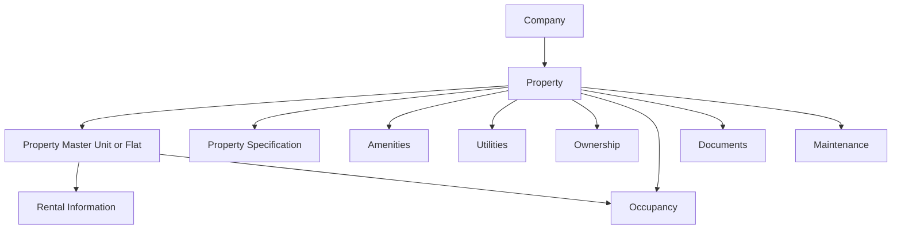
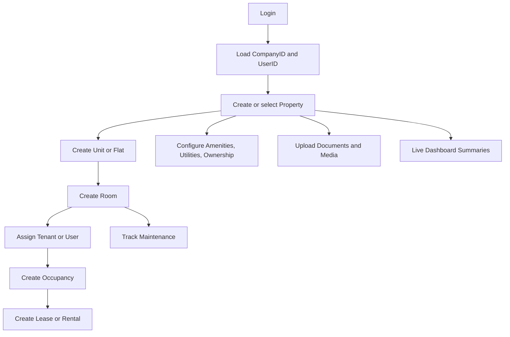

# Property Management Workflow

## Purpose

This document describes the property-management module workflow, entity relationships, API integration, and the remaining work required for complete property-wise, unit/room-wise, and user-wise management.

## Entry Point

The module starts at `PropertyManagementPage` in `lib/features/property_management/property_management_page.dart`.

Available sections:

- Dashboard
- Property Information
- Property Master
- Property Specification
- Amenities
- Utilities
- Ownership
- Occupancy
- Rental Information
- Maintenance
- Documents
- Financial
- Media

Financial and Media currently open the generic placeholder page because they are not handled by the navigation switch.

## Session Context

All property operations require the current session context:

```text
CompanyID  Current company
UserID     Logged-in user and audit user
PropertyID Selected property
```

`CompanyID` and `UserID` are read from `lib/core/session_store.dart`. A screen should stop the operation and request login again when either required value is missing.

## Current Entity Relationship



The current implementation uses `PropertyID` as the common property-level foreign key. `PropertyMaster.RecordID` identifies a unit or flat and is used by Rental Information.

## Standard Workflow

### 1. Select company and authenticate

Login stores the current company and user in `SessionStore`.

```text
Login -> CompanyID + UserID -> Property Management
```

### 2. Create the property

Use Property Information to create the parent property record.

Typical data:

- Property name and code
- Building and unit information
- Unit type and category
- Tower, wing, block, and community
- City, state, country, and postal code
- GPS location and map link

API operations:

```text
GET  /getPropertyInformation
GET  /getPropertyInformationByID
POST /insertUpdateProperty
POST /deletePropertyInformation
```

The successful insert returns or creates the `PropertyID` required by all child modules.

### 3. Configure property-level details

After selecting a property, configure the property-level modules:

| Module | Current relationship | Main purpose |
| --- | --- | --- |
| Property Specification | `PropertyID` | Bedrooms, bathrooms, maid/store/laundry rooms, and physical details |
| Amenities | `PropertyID` | Amenities available at the property |
| Utilities | `PropertyID` | Utility accounts, payments, and utility details |
| Ownership | `PropertyID` | Owner records and ownership details |
| Documents | `PropertyID` | Property document upload, listing, and deletion |
| Maintenance | `PropertyID` | Maintenance issues and work records |
| Occupancy | `PropertyID` | Occupancy and vacancy records |

Each screen loads the property list using `CompanyID`, then loads records for the selected `PropertyID`.

### 4. Create units or flats

Property Master represents the current unit/flat layer.

```text
Property
  -> Property Master record
       -> RecordID
       -> FlatNo
       -> FlatType
       -> TenantName
       -> RentalAmount
       -> Cheques
```

API operations:

```text
GET  /getPropertyMaster
GET  /getPropertyMasterByID
POST /insertUpdatePropertyMaster
POST /deletePropertyMaster
```

The list is filtered by both `CompanyID` and `PropertyID`.

### 5. Add occupancy

Occupancy currently supports:

- Occupancy or Vacancy
- Tenant name
- Check-in and check-out dates
- Inspection status
- Key handover status
- Access-card details
- Notes

API operations:

```text
GET  /getPropertyOccupancy
POST /insertUpdatePropertyOccupancy
POST /deletePropertyOccupancy
```

Current records are property-wise. To make them unit-wise, they must also store `RecordID` or a dedicated `UnitID`.

### 6. Add rental information

Rental Information first selects a property, then loads Property Master records as rental units.

```text
PropertyID -> PropertyMaster.RecordID -> Rental
```

Rental data includes:

- Tenant
- Lease start and end dates
- Monthly and annual rent
- Security deposit
- Payment frequency
- Number of cheques
- Rent increase percentage
- Grace period
- Renewal status

API operations:

```text
GET  /getPropertyRental
GET  /getPropertyRentalByID
POST /insertUpdatePropertyRental
POST /deletePropertyRental
```

### 7. Track maintenance

Maintenance currently uses `PropertyID` as its scope.

For complete unit or room tracking, maintenance should additionally store:

```text
UnitID or PropertyMaster.RecordID
RoomID, when the issue belongs to a room
AssignedUserID
```

### 8. Review dashboard data

The dashboard displays property statistics, vacancies, lease expiries, and income. The current dashboard values are static sample values and are not yet connected to the property APIs.

The dashboard should eventually aggregate:

```text
Property count
Unit count
Occupied units
Vacant units
Active rentals
Expiring leases
Open maintenance issues
Monthly rental income
```

## API Integration Pattern

Property screens generally follow this pattern:

```text
1. Read CompanyID and UserID from SessionStore
2. Load properties for CompanyID
3. User selects a property
4. Load child records using CompanyID + PropertyID
5. Create or edit a record
6. Send PropertyID, CompanyID, and audit user ID
7. Reload the selected property records
```

Create/update requests normally include:

```json
{
  "CompanyID": 1,
  "PropertyID": 100,
  "UserID": 25
}
```

Delete requests should also include the record identifier and the user performing the deletion.

## Target Unit and Room Relationship

The current application has no dedicated `RoomID` or room screen. Property Master is currently the closest unit/flat representation.

The target relationship should be:

```text
Company
  -> User
  -> Property
       -> Unit or Flat
            -> Room
                 -> Occupant or Tenant
                 -> Occupancy
                 -> Rental
                 -> Maintenance
```

Recommended identifiers:

```text
PropertyID
UnitID or PropertyMaster.RecordID
RoomID
TenantID or OccupantUserID
AssignedUserID
```

Recommended room fields:

- Room number
- Room type
- Floor
- Room status
- Furnished status
- Current occupant
- Notes

## Target User-Wise Workflow

The current `UserID` is mainly used for audit fields such as `CreatedBy`, `ModifiedBy`, and `DeletedBy`. It is not yet a tenant or assignment relationship.

For user-wise management, use foreign keys instead of relying only on names:

```text
User or Tenant
  -> TenantID / UserID
       -> Occupancy
       -> Rental
       -> Assigned maintenance
       -> Assigned property or unit
```

Required user-wise capabilities:

- List properties assigned to a user
- List units occupied by a user
- List rentals belonging to a user
- List maintenance tasks assigned to a user
- Filter records by user and status
- Preserve created, modified, and deleted audit users

`TenantName` should remain a display field, while `TenantID` or `OccupantUserID` should become the actual relationship.

## Remaining Implementation Work

1. Add a dedicated Unit or Room model with `UnitID` and `RoomID`.
2. Add room list, create, edit, and delete APIs and a Flutter screen.
3. Add `UnitID` or `RecordID` to Occupancy and Maintenance.
4. Add `TenantID` or `OccupantUserID` to Occupancy and Rental.
5. Add user-wise filtering and assignment screens.
6. Connect the dashboard to live summary APIs.
7. Implement Financial and Media navigation and APIs.
8. Standardize API base URL usage between `ApiConfig.baseUrl` and `kAseefaWebUrl`.
9. Add integration tests for property, unit, room, and user filtering.

## End-to-End Target Flow


